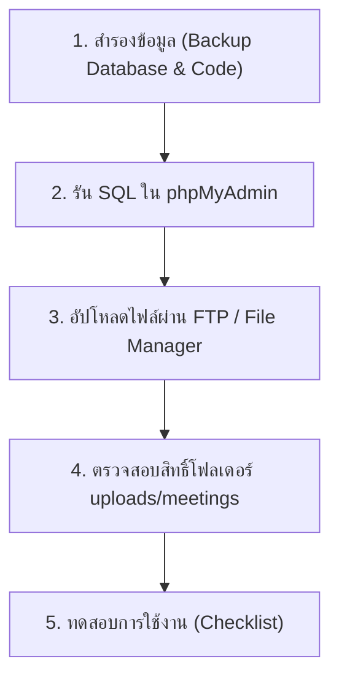

# คู่มือการนำระบบขึ้นเซิร์ฟเวอร์จริง (Production Deployment Guide)
> **ระบบ E-Office วิทยาลัยดุริยางคศิลป์ มหาวิทยาลัยมหาสารคาม**  
> *เอกสารนี้จะได้รับการอัปเดตทุกครั้งที่มีการแก้ไขโค้ดหรือฐานข้อมูล เพื่อให้ผู้ดูแลระบบสามารถนำขึ้นโฮสต์จริงได้ทันทีโดยไม่ต้องค้นหาไฟล์ใหม่*

---

## 📌 สารบัญด่วน
1. [รายการไฟล์ที่ต้องอัปโหลดขึ้นโฮสต์ (ล่าสุด)](#1-รายการไฟล์ที่ต้องอัปโหลดขึ้นโฮสต์)
2. [คำสั่งฐานข้อมูล SQL (Database Updates)](#2-คำสั่งฐานข้อมูล-sql)
3. [โฟลเดอร์ที่ต้องสร้างและการตั้งค่าสิทธิ์ (Permissions)](#3-โฟลเดอร์และการตั้งค่าสิทธิ์)
4. [ขั้นตอนการนำขึ้นโฮสต์ทีละขั้นตอน (Step-by-Step)](#4-ขั้นตอนการนำขึ้นโฮสต์จริง)
5. [รายการตรวจสอบหลังขึ้นโฮสต์ (Verification Checklist)](#5-รายการตรวจสอบหลังขึ้นโฮสต์)
6. [บันทึกประวัติการแก้ไขและไฟล์ที่เกี่ยวข้อง (Changelog)](#6-ประวัติการแก้ไข)

---

## 1. รายการไฟล์ที่ต้องอัปโหลดขึ้นโฮสต์

### 🔹 ตัวเลือกที่ 1: อัปโหลดเฉพาะไฟล์ที่มีการแก้ไขล่าสุด (ระบบการประชุม)
หากบนโฮสต์จริงมีระบบเดิมอยู่แล้ว ให้อัปโหลดทับเฉพาะไฟล์ดังต่อไปนี้:

| ลำดับ | ที่อยู่ไฟล์ (Path) | หน้าที่ / รายละเอียดการแก้ไข |
|:---:|:---|:---|
| 1 | `modules/meetings/manage_agendas.php` | ปรับปรุงหน้าจัดการวาระ, รองรับ Rich Text และตาราง, เพิ่มปุ่มดึงไฟล์จากกล่องรับเอกสาร, ปรับดีไซน์หัวข้อวาระแถวเดียว, ตัดปุ่มแก้ไขซ้ำซ้อน |
| 2 | `modules/meetings/index.php` | จำกัดสิทธิ์การมองเห็นการประชุมเร็วๆ นี้ (ผู้ใช้ทั่วไปเห็นเฉพาะที่มีชื่อเข้าร่วม, Admin เห็นทั้งหมด), ลิงก์แดชบอร์ดผู้บริหาร, ปรับแท็บให้กระชับสวยงาม |
| 3 | `modules/meetings/dashboard_admin.php` | แดชบอร์ดภาพรวมการประชุมสำหรับผู้บริหาร (Admin, หัวหน้าสำนักงาน, รองบริหาร, คณบดี) แสดงทุกการประชุม |
| 4 | `modules/meetings/meeting_room.php` | **[อัปเดตใหญ่]** เพิ่มตัวแสดงเอกสาร Word (`.docx`) และ Excel (`.xlsx`, `.xls`, `.csv`) ภายในหน้าห้องประชุม ทั้งแบบดูย่อในการ์ดวาระ (In-Card Preview) และแบบขยายเต็มจอควบคู่กับการพิมพ์มติที่ประชุม (Split-Screen Modal) |
| 5 | `assets/js/docx-preview.min.js` | **[ใหม่]** ไลบรารีเรนเดอร์เอกสาร Word (.docx) ฝั่ง Client เสมือนหน้ากระดาษ A4 จริง |
| 6 | `assets/js/jszip.min.js` | **[ใหม่]** ไลบรารีแตกไฟล์ชุดเอกสาร Office Open XML รองรับการอ่านไฟล์ Word และ Excel |
| 7 | `assets/js/xlsx.full.min.js` | **[ใหม่]** ไลบรารี SheetJS อ่านไฟล์ Excel (.xlsx, .xls, .csv) แปลงเป็นตาราง HTML พร้อมแท็บสลับ Sheet |
| 8 | `modules/meetings/manage_meeting.php` | ซ่อนปุ่ม "ลบการประชุม" สำหรับผู้ใช้ทั่วไป (ให้เฉพาะ Admin ลบได้เท่านั้น) |
| 9 | `modules/meetings/document_center.php` | หน้ากล่องส่งเอกสารวาระการประชุมล่วงหน้า |
| 10 | `modules/meetings/draft_minutes.php` | หน้าร่างรายงานการประชุม (รองรับข้อความและตาราง) |
| 11 | `modules/meetings/view.php` | หน้ารายละเอียดการประชุมและดูวาระ |
| 12 | `modules/meetings/ajax_heartbeat.php` | ระบบรักษาเซสชันอัตโนมัติ (Heartbeat Ping ทุก 90 วิ) ป้องกันเซสชันหลุดระหว่างการประชุมยาวนาน 2-3 ชม. |
| 13 | `uploads/meetings/.htaccess` | ไฟล์ความปลอดภัย ป้องกันการรันสคริปต์อันตรายในโฟลเดอร์อัปโหลด |
| 14 | `includes/app_center_modal.php` | เชื่อมโยงโมดูลการจัดการ "ขอเปิดรายวิชา" และ "คำร้องสำรองที่นั่ง" เข้า App Center หมวดวิชาการและพัฒนานิสิต พร้อมป้องกันข้อผิดพลาดตัวแปร bookmarks และสิทธิ์ |
| 15 | `modules/open_course/index.php` | **[ใหม่]** หน้าจัดการคำร้องขอเปิดรายวิชา (ตาราง, กรองสถานะ, คิวรอฉันพิจารณา, สถิติ, โหลด footer + Bootstrap JS เปิด Modal ได้สมบูรณ์) |
| 16 | `modules/open_course/view.php` | **[ใหม่]** หน้ารายละเอียดและพิจารณาอนุมัติ/ไม่อนุมัติคำร้องขอเปิดรายวิชา (Workflow Timeline 5 ขั้น, โหลด footer + Bootstrap JS) |
| 17 | `modules/reserve_seat/index.php` | **[ใหม่]** หน้าจัดการคำร้องขอสำรองที่นั่ง (ตารางแสดงกลุ่ม Sec, คิวรอฉันพิจารณา, สถิติ, โหลด footer + Bootstrap JS เปิด Modal ได้สมบูรณ์) |
| 18 | `modules/reserve_seat/view.php` | **[ใหม่]** หน้ารายละเอียดและพิจารณาอนุมัติ/ไม่อนุมัติคำร้องขอสำรองที่นั่ง (Workflow Timeline 5 ขั้น, โหลด footer + Bootstrap JS) |
| 19 | `e-service/includes/mailer.php` | **[ใหม่]** ฟังก์ชันส่งอีเมลแจ้งเตือนอาจารย์ผู้สอนเมื่อนิสิตยื่นคำร้อง (ใช้ PHPMailer + Gmail SMTP สไตล์เดียวกับ music-cert) |
| 20 | `e-service/PHPMailer/` | โฟลเดอร์ไลบรารี PHPMailer สำหรับระบบ e-Service |
| 21 | `e-service/request_open_course.php` | ปรับปรุงให้เรียกฟังก์ชันส่งอีเมลอัตโนมัติหลังบันทึกคำร้องขอเปิดรายวิชาสำเร็จ |
| 22 | `e-service/request_reserve_seat.php` | ปรับปรุงให้เรียกฟังก์ชันส่งอีเมลอัตโนมัติหลังบันทึกคำร้องขอสำรองที่นั่งสำเร็จ |
| 23 | `includes/mailer.php` | ไฟล์ระบบส่งอีเมลกลางสำหรับฝั่ง e-Office (เพิ่มฟังก์ชันแจ้งเตือนอาจารย์และแจ้งผลคำร้องแก่นิสิต) |
| 24 | `includes/PHPMailer/` | โฟลเดอร์ไลบรารี PHPMailer สำหรับฝั่ง e-Office |
| 25 | `requests_approve.php` | **[อัปเดต]** หน้าพิจารณาคำร้องนิสิต (เชื่อมโยงจากศูนย์อนุมัติรวม requests_list.php): รองรับ Admin Override, ตรวจสอบสิทธิ์ด้วย Role Name + Role ID, แสดงรูปโปรไฟล์ Google OAuth ถูกต้อง, แสดงกลุ่ม Sec, และส่งอีเมลแจ้งเตือนขั้นตอนถัดไป |
| 26 | `includes/sidebar.php` | **[อัปเดต]** ปรับปรุงพาธ include ของ App Center Modal ให้เป็น Absolute Path ป้องกันปัญหา modal ไม่ทำงานในโฟลเดอร์โมดูลย่อย |
| 27 | `modules/supplies/report.php` | **[อัปเดตใหญ่]** เพิ่มหน้ารายงานวัสดุคงเหลือ: นำเข้า (รับเข้า), วันที่นำเข้า, นำออก (จ่ายออก), วันที่นำออกล่าสุด, คงคลัง (คงเหลือ) จัดกลุ่มตามประเภทและชื่อรายการวัสดุ พร้อมปุ่มดูประวัติรายการที่นำออกรายชิ้นผ่าน Modal, แท็บประวัติรายการที่นำออกทั้งหมด (Transaction Log รายชิ้น), และส่งออก CSV ครบทุกแท็บ |
| 28 | `modules/supplies/manage_items.php` | **[อัปเดต]** เพิ่มฟิลด์ "วันที่นำเข้า / รับเข้าคลัง" ในฟอร์มเพิ่ม/แก้ไขวัสดุ, แสดงคอลัมน์ "วันที่นำเข้า" ในตาราง และปุ่มทางลัดไปยังหน้ารายงานวัสดุคงเหลือ |
| 29 | `deploy_supplies.sql` | **[ใหม่]** ไฟล์สคริปต์ SQL สำหรับอัปเดตตาราง `supplies_items` เพิ่มคอลัมน์ `received_date` และ `created_at` บนโฮสต์จริง |
| 30 | `modules/attendance/process_scan.php` | **[แก้ไขด่วน]** แก้ปัญหา `Data truncated for column 'user_id'` บนโฮสต์จริง + ป้องกันการลงเวลาเข้างาน/ออกงานซ้ำในวันเดียวกัน (จำกัดเข้างาน 1 ครั้ง และออกงาน 1 ครั้งต่อวัน) |
| 31 | `modules/attendance/public_scan.php` | แสดงสถานะการลงเวลาประจำวันในตัวเลือกรายชื่อ, ปิดปุ่มที่ลงเวลาไปแล้วอัตโนมัติป้องกันการกดซ้ำ, รีเซ็ตข้ามวันอัตโนมัติ และรองรับรูปโปรไฟล์ทุกแบบ |
| 32 | `modules/attendance/index.php` | เพิ่มระบบตรวจสอบและอัปเกรดชนิดคอลัมน์ `attendance_logs.user_id` อัตโนมัติ |
| 33 | `modules/attendance/my_attendance.php` | เพิ่มระบบตรวจสอบและอัปเกรดชนิดคอลัมน์ `attendance_logs.user_id` อัตโนมัติ |
| 34 | `deploy_attendance.sql` | **[ใหม่]** ไฟล์สคริปต์ SQL สำหรับเปลี่ยน `attendance_logs.user_id` เป็น `VARCHAR(50)` บนโฮสต์จริงผ่าน phpMyAdmin |
| 35 | `e-service/request_room.php` | **[อัปเดตใหญ่]** เพิ่มแท็บสลับระหว่าง "ยื่นขอจองห้อง" และ "รายการจองของฉัน", แสดงสถานะทุกรายการ, ปุ่มยกเลิกการจองพร้อม Modal ให้ระบุสาเหตุ, และกล่องแสดงเหตุผลเมื่อรายการถูกยกเลิก/ปฏิเสธ |
| 36 | `e-service/view_booking.php` | **[อัปเดต]** เพิ่มปุ่ม "ยกเลิกการจองห้องนี้" สำหรับรายการรอพิจารณา (pending) และอนุมัติแล้ว (approved) พร้อม Modal ระบุสาเหตุ และกล่องแสดงเหตุผลเมื่อสถานะเป็นยกเลิกแล้ว (cancelled) |
| 37 | `e-service/cancel_room_booking.php` | **[ใหม่]** จุดประมวลผลการยกเลิกการจองห้องพัก/ห้องเรียนสำหรับนิสิต ตรวจสอบสิทธิ์เจ้าของรายการ บันทึกสถานะ `cancelled` และเก็บสาเหตุใน `reject_reason` พร้อมแจ้งเตือนในระบบ |
| 38 | `modules/room_booking/cancel_booking.php` | **[อัปเดต]** รองรับการรับค่าเหตุผลการยกเลิกจากฟอร์ม (`cancel_reason`) บันทึกลงในฐานข้อมูลแทนข้อความคงที่ |
| 39 | `e-service/includes/practice_functions.php` | **[ใหม่]** ฟังก์ชันกลางห้องซ้อมดนตรี: Auto-Cancel No-show (หลัง 15 นาที), ตรวจสอบกฎ No-show 3 ครั้งใน 30 วัน แบน 7 วัน, ฟังก์ชัน Badge สถานะ |
| 40 | `e-service/request_practice_room.php` | **[อัปเดตใหญ่]** เพิ่มแท็บสลับ "จองห้องซ้อม" และ "รายการจองของฉัน", บล็อกและแจ้งเตือนการถูกระงับสิทธิ์จองล่วงหน้า 7 วัน (เมื่อ No-show ครบ 3 ครั้ง), Modal ยกเลิกการจองพร้อมระบุเหตุผล |
| 41 | `e-service/view_practice_booking.php` | **[อัปเดตใหญ่]** แสดง QR Code และรหัส 6 หลักสำหรับบังคับ Check-in ที่เครื่อง Terminal หน้าห้อง (ภายใน 15 นาที), เพิ่มปุ่ม "Check-out คืนห้องซ้อม (เลิกก่อนเวลา)", กล่องเตือน No-show, และ Modal ยกเลิกการจองพร้อมระบุเหตุผล |
| 42 | `e-service/cancel_practice_booking.php` | **[อัปเดต]** บันทึกเหตุผลการยกเลิกห้องซ้อม (`cancel_reason`) พร้อมแจ้งเตือนในระบบ |
| 43 | `e-service/api_terminal.php` | **[อัปเดต]** จำกัดเวลา Check-in 15 นาทีจากเวลาเริ่ม (เกินตัด no_show ทันที), เมื่อ Check-out ตัดเวลา `end_time = CURTIME()` คืนห้องว่างทันที (Real-time Release) |
| 44 | `e-service/api_practice_schedule.php` | **[อัปเดต]** กรองเฉพาะรายการที่ active/approved (ปลดล็อก slot จาก cancelled, no_show และ early check-out ให้ผู้อื่นจองต่อได้ทันที) |
| 45 | `e-service/api_practice_map.php` | **[อัปเดต]** ซิงค์ระบบตรวจจับ No-Show อัตโนมัติ อัปเดตสถานะห้องว่างแบบ Real-time |
| 46 | `e-service/history.php` | **[อัปเดต]** รองรับ Badge สถานะ `no_show` (ไม่มาตามนัด) |
| 47 | `e-service/index.php` | **[อัปเดต]** ซิงค์ระบบตรวจจับ No-Show อัตโนมัติ |
| 48 | `deploy_practice_smart.sql` | **[ใหม่]** สคริปต์ SQL อัปเดตตาราง `practice_bookings` เพิ่มสถานะ `no_show`, คอลัมน์ `check_in_at`, `check_out_at`, `cancel_reason` |

> 💡 **สรุปสำหรับอัปเดตล่าสุด (ระบบ Smart Practice Room Booking 5 ข้อ + ยกเลิกพร้อมระบุเหตุผล):**
> 1. **รันคำสั่ง SQL บน phpMyAdmin ของโฮสต์จริง** (หรือนำเข้าไฟล์ `deploy_practice_smart.sql`):
>    ```sql
>    ALTER TABLE `practice_bookings` 
>      MODIFY COLUMN `status` ENUM('approved','active','completed','cancelled','no_show') DEFAULT 'approved',
>      ADD COLUMN IF NOT EXISTS `check_in_at` DATETIME NULL AFTER `status`,
>      ADD COLUMN IF NOT EXISTS `check_out_at` DATETIME NULL AFTER `check_in_at`,
>      ADD COLUMN IF NOT EXISTS `cancel_reason` TEXT NULL AFTER `check_out_at`;
>    ```
> 2. **อัปโหลดไฟล์ไปยังเซิร์ฟเวอร์จริง:**
>    - `e-service/includes/practice_functions.php` *(ไฟล์ใหม่)*
>    - `e-service/request_practice_room.php`
>    - `e-service/view_practice_booking.php`
>    - `e-service/cancel_practice_booking.php`
>    - `e-service/api_terminal.php`
>    - `e-service/api_practice_schedule.php`
>    - `e-service/api_practice_map.php`
>    - `e-service/history.php`
>    - `e-service/index.php`

> 💡 **สรุปสำหรับอัปเดตล่าสุด (ระบบยกเลิกการจองห้องพร้อมระบุสาเหตุ - e-Service):**
> **อัปโหลดไฟล์ไปยังเซิร์ฟเวอร์จริง:**
> 1. `e-service/request_room.php`
> 2. `e-service/view_booking.php`
> 3. `e-service/cancel_room_booking.php` *(ไฟล์ใหม่)*
> 4. `music-e-office/modules/room_booking/cancel_booking.php`
> *(ฐานข้อมูล `room_bookings` มีคอลัมน์ `reject_reason` และสถานะ `cancelled` รองรับอยู่แล้ว ไม่ต้องรัน SQL เพิ่มเติม)*

> 💡 **สรุปสำหรับอัปเดตล่าสุด (แก้ Error ระบบลงเวลา `public_scan.php` บนโฮสต์จริง):**
> 1. **รันคำสั่ง SQL บน phpMyAdmin ของโฮสต์จริง** (หรือนำเข้าไฟล์ `deploy_attendance.sql`):
>    ```sql
>    ALTER TABLE `attendance_logs` MODIFY COLUMN `user_id` VARCHAR(50) CHARACTER SET utf8mb4 COLLATE utf8mb4_unicode_ci NOT NULL;
>    ```
> 2. **อัปโหลดไฟล์ทับในโฟลเดอร์ `modules/attendance/`:**
>    - `modules/attendance/process_scan.php` *(มีระบบแก้ชนิดคอลัมน์ `user_id` และสร้างโฟลเดอร์ `uploads/attendance/` ให้อัตโนมัติด้วย)*
>    - `modules/attendance/public_scan.php`
>    - `modules/attendance/index.php`
>    - `modules/attendance/my_attendance.php`
> 3. ตรวจสอบสิทธิ์โฟลเดอร์ `uploads/attendance/` บนโฮสต์จริงให้เขียนไฟล์ได้ (`755` หรือ `775`)

> 💡 **สรุปสำหรับอัปเดตก่อนหน้า (ระบบห้องประชุม เปิดดู PDF / รูปภาพ / Word / Excel ในหน้าได้):**
> 1. อัปโหลดไฟล์ใน `modules/meetings/`:
>    - `modules/meetings/meeting_room.php`
>    - `modules/meetings/manage_agendas.php`
>    - `modules/meetings/document_center.php`
> 2. อัปโหลดไฟล์ไลบรารี 3 ไฟล์ในโฟลเดอร์ `assets/js/`:
>    - `assets/js/jszip.min.js`
>    - `assets/js/docx-preview.min.js`
>    - `assets/js/xlsx.full.min.js`
> *(การอัปเดตรอบนี้ไม่ต้องรัน SQL เพิ่มเติม)*


> 💡 **คำแนะนำ:** หากต้องการความมั่นใจและป้องกันปัญหาไฟล์เวอร์ชันไม่ตรงกัน แนะนำให้อัปโหลดไฟล์ทั้งหมดในโฟลเดอร์ `modules/meetings/` ขึ้นไปทั้งโฟลเดอร์ได้เลย

---

## 2. คำสั่งฐานข้อมูล SQL

หากฐานข้อมูลบนโฮสต์จริงยังไม่มีตารางที่เกี่ยวข้อง หรืออัปเดตจากเวอร์ชันเก่า ให้คัดลอกคำสั่งด้านล่างนี้ไปรันใน **phpMyAdmin** (หรือนำเข้าไฟล์ `deploy_meetings.sql` ที่อยู่ในโฟลเดอร์หลักของโปรเจกต์):

```sql
-- ====================================================================
-- สคริปต์ฐานข้อมูลระบบการประชุม (E-Meeting) สำหรับเซิร์ฟเวอร์จริง
-- รองรับ MySQL 5.7+ / MariaDB 10.2+ / phpMyAdmin
-- ====================================================================

SET FOREIGN_KEY_CHECKS = 0;

-- 1. ตารางการประชุมหลัก (meetings)
CREATE TABLE IF NOT EXISTS `meetings` (
  `meeting_id` int(11) NOT NULL AUTO_INCREMENT,
  `title` varchar(255) NOT NULL COMMENT 'ชื่อการประชุม',
  `meeting_no` varchar(50) NOT NULL COMMENT 'ครั้งที่ประชุม เช่น 1/2569',
  `meeting_date` date NOT NULL COMMENT 'วันที่ประชุม',
  `start_time` time NOT NULL COMMENT 'เวลาเริ่ม',
  `end_time` time DEFAULT NULL COMMENT 'เวลาสิ้นสุด',
  `location` varchar(255) DEFAULT NULL COMMENT 'สถานที่ประชุม / ลิงก์ออนไลน์',
  `status` enum('draft','upcoming','in_progress','completed') DEFAULT 'draft' COMMENT 'สถานะการประชุม',
  `minutes_content` longtext DEFAULT NULL COMMENT 'เนื้อหารายงานการประชุมฉบับร่าง/สมบูรณ์',
  `previous_meeting_id` int(11) DEFAULT NULL COMMENT 'อ้างอิงการประชุมครั้งก่อนหน้านี้',
  `created_by` varchar(20) NOT NULL COMMENT 'รหัสผู้สร้าง',
  `created_at` timestamp NOT NULL DEFAULT CURRENT_TIMESTAMP,
  PRIMARY KEY (`meeting_id`)
) ENGINE=InnoDB DEFAULT CHARSET=utf8mb4 COLLATE=utf8mb4_unicode_ci;

-- 2. ตารางวาระการประชุม (meeting_agendas)
CREATE TABLE IF NOT EXISTS `meeting_agendas` (
  `agenda_id` int(11) NOT NULL AUTO_INCREMENT,
  `meeting_id` int(11) NOT NULL COMMENT 'รหัสการประชุม',
  `agenda_number` varchar(20) NOT NULL COMMENT 'เลขวาระ เช่น 1, 1.1, 2',
  `agenda_title` varchar(255) NOT NULL COMMENT 'หัวข้อวาระ',
  `agenda_detail` text DEFAULT NULL COMMENT 'รายละเอียด / ข้อเท็จจริง (รองรับ HTML/ตาราง)',
  `proposal` text DEFAULT NULL COMMENT 'ประเด็นเสนอ',
  `resolution` text DEFAULT NULL COMMENT 'มติที่ประชุม',
  `assigned_to` varchar(255) DEFAULT NULL COMMENT 'ผู้รับผิดชอบดำเนินการ',
  `sort_order` int(11) NOT NULL DEFAULT 0 COMMENT 'ลำดับการเรียง',
  PRIMARY KEY (`agenda_id`),
  KEY `meeting_id` (`meeting_id`),
  CONSTRAINT `meeting_agendas_ibfk_1` FOREIGN KEY (`meeting_id`) REFERENCES `meetings` (`meeting_id`) ON DELETE CASCADE
) ENGINE=InnoDB DEFAULT CHARSET=utf8mb4 COLLATE=utf8mb4_unicode_ci;

-- 3. ตารางเอกสารแนบประจำวาระ (meeting_attachments)
CREATE TABLE IF NOT EXISTS `meeting_attachments` (
  `attachment_id` int(11) NOT NULL AUTO_INCREMENT,
  `agenda_id` int(11) NOT NULL COMMENT 'รหัสวาระ',
  `file_name` varchar(255) NOT NULL COMMENT 'ชื่อไฟล์เดิม',
  `file_path` varchar(255) NOT NULL COMMENT 'พาธไฟล์ที่จัดเก็บบนเซิร์ฟเวอร์',
  `uploaded_at` timestamp NOT NULL DEFAULT CURRENT_TIMESTAMP,
  PRIMARY KEY (`attachment_id`),
  KEY `agenda_id` (`agenda_id`),
  CONSTRAINT `meeting_attachments_ibfk_1` FOREIGN KEY (`agenda_id`) REFERENCES `meeting_agendas` (`agenda_id`) ON DELETE CASCADE
) ENGINE=InnoDB DEFAULT CHARSET=utf8mb4 COLLATE=utf8mb4_unicode_ci;

-- 4. ตารางรายชื่อผู้เข้าร่วมประชุม (meeting_attendees)
CREATE TABLE IF NOT EXISTS `meeting_attendees` (
  `attendee_id` int(11) NOT NULL AUTO_INCREMENT,
  `meeting_id` int(11) NOT NULL COMMENT 'รหัสการประชุม',
  `user_id` varchar(20) NOT NULL COMMENT 'รหัสผู้ใช้งาน',
  `attendance_status` enum('pending','attending','absent') DEFAULT 'pending' COMMENT 'สถานะตอบรับ',
  `attend_mode` enum('onsite','online') DEFAULT NULL COMMENT 'รูปแบบเข้าร่วม',
  `absence_reason` text DEFAULT NULL COMMENT 'เหตุผลกรณีลาประชุม',
  PRIMARY KEY (`attendee_id`),
  KEY `meeting_id` (`meeting_id`),
  CONSTRAINT `meeting_attendees_ibfk_1` FOREIGN KEY (`meeting_id`) REFERENCES `meetings` (`meeting_id`) ON DELETE CASCADE
) ENGINE=InnoDB DEFAULT CHARSET=utf8mb4 COLLATE=utf8mb4_unicode_ci;

-- 5. ตารางกล่องรับเอกสารวาระล่วงหน้า (meeting_submissions) *** สำคัญมาก สำหรับฟีเจอร์ส่งเอกสารวาระ ***
CREATE TABLE IF NOT EXISTS `meeting_submissions` (
  `submission_id` int(11) NOT NULL AUTO_INCREMENT,
  `meeting_id` int(11) NOT NULL COMMENT 'รหัสการประชุมที่ส่งเข้า',
  `user_id` varchar(20) NOT NULL COMMENT 'รหัสผู้ส่งเอกสาร',
  `original_file_name` varchar(255) NOT NULL COMMENT 'ชื่อไฟล์ต้นฉบับ',
  `file_path` varchar(255) NOT NULL COMMENT 'พาธไฟล์ที่จัดเก็บบนเซิร์ฟเวอร์',
  `note` text DEFAULT NULL COMMENT 'บันทึก/หมายเหตุจากผู้ส่ง',
  `status` enum('pending','assigned','rejected') DEFAULT 'pending' COMMENT 'สถานะเอกสาร',
  `submitted_at` timestamp NOT NULL DEFAULT CURRENT_TIMESTAMP,
  PRIMARY KEY (`submission_id`),
  KEY `meeting_id` (`meeting_id`),
  CONSTRAINT `meeting_submissions_ibfk_1` FOREIGN KEY (`meeting_id`) REFERENCES `meetings` (`meeting_id`) ON DELETE CASCADE
) ENGINE=InnoDB DEFAULT CHARSET=utf8mb4 COLLATE=utf8mb4_unicode_ci;

SET FOREIGN_KEY_CHECKS = 1;
```

### 2.1 คำสั่งฐานข้อมูลระบบพัสดุ (Supplies Module)
รันคำสั่งนี้เพื่อเพิ่มฟิลด์ `received_date` (วันที่นำเข้า) และ `created_at` (วันที่สร้าง) ในตาราง `supplies_items` (หรือนำเข้าไฟล์ `deploy_supplies.sql`):

```sql
-- เพิ่มคอลัมน์ received_date และ created_at ในตาราง supplies_items
ALTER TABLE `supplies_items` 
  ADD COLUMN `received_date` DATE DEFAULT NULL COMMENT 'วันที่นำเข้า/รับเข้าคลัง' AFTER `stock_qty`,
  ADD COLUMN `created_at` TIMESTAMP NOT NULL DEFAULT CURRENT_TIMESTAMP COMMENT 'วันที่บันทึกเข้าระบบ' AFTER `is_active`;

-- กำหนดวันที่นำเข้าเริ่มต้นให้กับข้อมูลเดิมที่มีอยู่ (เพื่อให้มีวันที่แสดงในรายงาน)
UPDATE `supplies_items` SET `received_date` = '2026-03-01' WHERE `received_date` IS NULL;
```


---

## 3. โฟลเดอร์และการตั้งค่าสิทธิ์

ตรวจสอบโฟลเดอร์สำหรับเก็บไฟล์อัปโหลดบนเซิร์ฟเวอร์ Linux / DirectAdmin / cPanel:

1. **สร้างโฟลเดอร์ (หากยังไม่มี):**
   ```bash
   mkdir -p uploads/meetings
   ```
2. **ตั้งค่าสิทธิ์เขียนไฟล์ (Permissions / CHMOD):**
   ```bash
   chmod 775 uploads/meetings
   # หรือหากเว็บเซิร์ฟเวอร์รันด้วย user อื่นและอัปโหลดไฟล์ไม่เข้า ให้ใช้:
   chmod 777 uploads/meetings
   ```
3. **ตรวจสอบไฟล์ความปลอดภัย:**
   - ตรวจสอบว่ามีไฟล์ `uploads/meetings/.htaccess` อัปโหลดขึ้นไปแล้ว เพื่อป้องกันการรันสคริปต์แปลกปลอม

---

## 3.1 การตั้งค่าอีเมลแจ้งเตือนอาจารย์ผู้สอน (Email Notification)

ระบบส่งอีเมลแจ้งเตือนอาจารย์ผู้สอน (เมื่อนิสิตยื่นคำร้องขอเปิดรายวิชา / สำรองที่นั่ง) ใช้เทคโนโลยีเดียวกับระบบ `music-cert` (PHPMailer + Gmail SMTP)

**ตำแหน่งที่ต้องระบุอีเมลและรหัสผ่าน:**
เปิดไฟล์ `e-service/includes/mailer.php` (และ `includes/mailer.php`) ที่ฟังก์ชัน `getSmtpConfig()`:
```php
function getSmtpConfig() {
    return [
        'host'       => 'smtp.gmail.com',
        'port'       => 465,
        'secure'     => PHPMailer::ENCRYPTION_SMTPS, // SSL
        'username'   => 'อีเมลผู้ส่ง@msu.ac.th', // <--- ระบุอีเมลที่ต้องการใช้ส่ง
        'password'   => 'รหัสผ่าน App Password 16 หลัก', // <--- นำ App Password จาก Google Account มาใส่ที่นี่
        'from_name'  => 'ระบบ e-Service วิทยาลัยดุริยางคศิลป์ มมส.'
    ];
}
```
> ⚠️ **หมายเหตุ:** หากยังไม่ได้ใส่รหัสผ่าน (`password = ''`) ระบบจะข้ามขั้นตอนการส่งอีเมลอย่างปลอดภัยโดยไม่ทำให้หน้าเว็บนิสิตขึ้น Error แต่อย่างใด และเมื่อใส่รหัสผ่านเรียบร้อย อีเมลจะเริ่มส่งออกไปยังอาจารย์ทันที

---

## 4. ขั้นตอนการนำขึ้นโฮสต์จริง



1. **สำรองข้อมูล (Backup):**
   - ส่งออก (Export) ฐานข้อมูลปัจจุบันบนโฮสต์จริงเก็บไว้ก่อน
   - บีบอัดไฟล์โฟลเดอร์ `modules/meetings/` เดิมบนโฮสต์จริงเก็บไว้เป็นไฟล์สำรอง (.zip)
2. **รันคำสั่ง SQL:**
   - เข้า phpMyAdmin ของโฮสต์จริง -> เลือกฐานข้อมูลระบบ e-Office
   - ไปที่แท็บ **SQL** -> คัดลอกคำสั่งในข้อ 2 ไปวางแล้วกด **Go (ดำเนินการ)**
   *(คำสั่งใช้ `CREATE TABLE IF NOT EXISTS` จะไม่ลบหรือทับข้อมูลเดิมที่มีอยู่แล้ว)*
3. **อัปโหลดไฟล์ (FTP / SFTP / File Manager):**
   - อัปโหลดไฟล์ตามตารางใน [ข้อ 1](#1-รายการไฟล์ที่ต้องอัปโหลดขึ้นโฮสต์) ไปยังพาธเดียวกันบนเซิร์ฟเวอร์
4. **ตรวจสอบสิทธิ์โฟลเดอร์:**
   - เช็คว่าโฟลเดอร์ `uploads/meetings/` มีสิทธิ์เขียนไฟล์ (775 หรือ 777)

---

## 5. รายการตรวจสอบหลังขึ้นโฮสต์

- [ ] เปิดหน้า `modules/meetings/index.php`:
  - ล็อกอินด้วย User ทั่วไป -> ต้องเห็นเฉพาะการประชุมที่ตนเองมีชื่อเข้าร่วม
  - ล็อกอินด้วย Admin -> ต้องเห็นการประชุมทั้งหมด
  - ผู้บริหาร (หัวหน้าสำนักงาน, รองบริหาร, คณบดี, Admin) -> มีปุ่ม "แดชบอร์ดผู้บริหาร"
- [ ] เปิดหน้า `modules/meetings/meeting_room.php`:
  - เข้าห้องประชุมแล้วหน้าจอโหลดปกติ **ต้องไม่มีการเด้งดาวน์โหลดไฟล์ Word อัตโนมัติ**
- [ ] เปิดหน้า `modules/meetings/manage_meeting.php`:
  - บัญชีทั่วไปต้อง **ไม่เห็น** ปุ่มลบการประชุมสีแดง (เฉพาะ Admin เท่านั้นที่เห็น)
- [ ] เปิดหน้า `modules/meetings/manage_agendas.php`:
  - ทดสอบแก้ไขวาระ สามารถใส่ข้อความ, ตัวหนา, ตัวเอียง, สีข้อความ และ **ตาราง HTML** ได้
  - ป้ายวาระแถวเดียว สีม่วง พร้อมปุ่มแก้ไขสีเหลือง และมีปุ่ม "เพิ่มเอกสารจากกล่องรับเอกสาร"
  - ด้านล่างการ์ดวาระไม่มีปุ่มแก้ไขซ้ำซ้อน
- [ ] เปิดหน้า `modules/meetings/document_center.php`:
  - สามารถส่งเอกสารแนบวาระล่วงหน้า และผู้จัดประชุมสามารถดึงไฟล์เข้าวาระได้
- [ ] เปิด App Center (แอปพลิเคชันและระบบงานหลัก) -> แท็บ "วิชาการและพัฒนานิสิต":
  - ตรวจสอบว่ามีการ์ด **"การจัดการขอเปิดรายวิชา"** และ **"การจัดการคำร้องสำรองที่นั่ง"**
  - คลิกแล้วเข้าสู่หน้าระบบการจัดการของอาจารย์ได้ถูกต้อง
- [ ] ทดสอบระบบการพิจารณาคำร้อง (`modules/open_course/` และ `modules/reserve_seat/`):
  - อาจารย์ผู้สอนและอาจารย์ที่ปรึกษาเห็นคำร้องที่นิสิตเลือกตนเองในแท็บ "⚡ รอฉันพิจารณา"
  - สามารถกด "พิจารณา" และเลือก "อนุมัติ" หรือ "ไม่อนุมัติ" พร้อมกรอกความเห็นได้
  - ลำดับขั้น (Workflow) เลื่อนไปขั้นตอนถัดไปอย่างถูกต้อง
- [ ] ทดสอบระบบรายงานและจัดการวัสดุคงเหลือ (`modules/supplies/`):
  - เปิดหน้า `modules/supplies/report.php?tab=stock`: ตรวจสอบคอลัมน์ "วันที่นำเข้า", "ยอดนำเข้า", "วันที่นำออกล่าสุด", "ยอดนำออก", "คงคลัง" แสดงผลถูกต้องครบถ้วน
  - กดปุ่ม "รายการที่นำออก" สีส้มของวัสดุใดๆ -> หน้าต่าง Modal ต้องเปิดแสดงประวัติการเบิกจ่ายของวัสดุนั้นพร้อมวันที่, เลขคำขอ, ผู้เบิก และผู้จ่าย
  - เปิดแท็บ "2. ประวัติรายการที่นำออกทั้งหมด": แสดงตาราง Log การตัดจ่ายพัสดุรายชิ้นเรียงตามวันที่นำออกล่าสุด
  - ทดสอบปุ่ม Export CSV: ดาวน์โหลดไฟล์และเปิดใน Excel ภาษาไทยไม่เป็นภาษาต่างดาว
  - เปิดหน้า `modules/supplies/manage_items.php`: ตรวจสอบคอลัมน์ "วันที่นำเข้า", ทดสอบกดปุ่มเพิ่ม/แก้ไขวัสดุมีช่องกรอก "วันที่นำเข้า / รับเข้าคลัง" และบันทึกค่าได้ถูกต้อง
- [ ] ทดสอบระบบเปิดดูเอกสาร Word (.docx) และ Excel (.xlsx, .xls) ในห้องประชุม (`modules/meetings/meeting_room.php`):
  - เปิดหน้า `meeting_room.php?id=4` (หรือการประชุมที่มีไฟล์แนบ):
  - **ทดสอบแบบ In-Card:** กดปุ่มเปิดดูเอกสารแบบย่อใต้การ์ดวาระ -> ไฟล์ Word แสดงผลเป็นหน้ากระดาษ A4 เสมือนจริง, ไฟล์ Excel แสดงเป็นตารางข้อมูลพร้อมแท็บสลับ Sheet
  - **ทดสอบแบบ Split-Screen เต็มจอ:** กดปุ่ม **"ขยายเต็มจอ + บันทึกมติ"** หรือ **"เปิดดูเอกสารคู่กับมติ"** -> ฝั่งซ้ายเปิดดูเอกสาร Word/Excel เลื่อนหน้า/สลับชีตได้เต็มตา ส่วนฝั่งขวาสามารถพิมพ์บันทึกมติที่ประชุมและกดบันทึกลงฐานข้อมูลได้ทันที

---

## 6. ประวัติการแก้ไข

| วันที่ | ผู้แก้ไข | รายการไฟล์ที่แก้ไข | รายละเอียด |
|:---:|:---:|:---|:---|
| **2026-10-30** | Agent / User | `modules/meetings/meeting_room.php`<br>`assets/js/docx-preview.min.js`<br>`assets/js/jszip.min.js`<br>`assets/js/xlsx.full.min.js` | **เพิ่มระบบเปิดดูไฟล์ Word (.docx) และ Excel (.xlsx, .xls, .csv) ในหน้าห้องประชุมได้โดยตรง:**<br>1. ติดตั้ง Client-Side Rendering Engines (`docx-preview` + `JSZip` + `SheetJS`) แบบ Local Assets ทำงานได้ 100% ทั้งบน Localhost และ Production โดยไม่ต้องพึ่งพาบริการ Cloud ภายนอก และรักษาความลับของเอกสารการประชุม<br>2. รองรับการเปิดดูแบบ **In-Card Preview** (ย่อดูใต้การ์ดวาระ) ด้วยระบบ Lazy Load โหลดเฉพาะไฟล์ที่เปิดดู<br>3. รองรับการเปิดดูแบบ **Fullscreen Split-Screen Modal** ฝั่งซ้ายแสดงเอกสาร Word (หน้า A4) หรือ Excel (ตารางข้อมูลพร้อมแท็บสลับชีต) ฝั่งขวาพิมพ์บันทึกมติที่ประชุมและมอบหมายผู้รับผิดชอบได้แบบ Real-time<br>4. เพิ่มไฟล์ตัวอย่าง Excel งบประมาณโครงการเข้าสู่ฐานข้อมูลการประชุมครั้งที่ 4 เพื่อให้ทดสอบได้ทันที |
| **2026-10-30** | Agent / User | `modules/supplies/report.php`<br>`modules/supplies/manage_items.php`<br>`deploy_supplies.sql` | 1. **เพิ่มหน้ารายงานวัสดุคงเหลือ (Stock Balance Report) ครบวงจร:**<br>- เพิ่มแท็บ 1: "รายงานวัสดุคงเหลือ (รับเข้า - นำออก - คงคลัง)" แสดงวันที่นำเข้า (Received Date), ยอดรับเข้า, วันที่นำออกล่าสุด (Last Issue Date), ยอดนำออก, คงคลัง จัดกลุ่มตามประเภทและชื่อวัสดุ<br>- เพิ่มปุ่มกดดู "รายการที่นำออก" ในตารางคงคลัง เปิด Modal ดึงประวัติการเบิกจ่ายของวัสดุนั้นๆ แบบ AJAX ทันที<br>- เพิ่มแท็บ 2: "ประวัติรายการที่นำออกทั้งหมด" (Issued Item Transactions Log) แสดงรายละเอียดการตัดจ่ายรายแถว (วันที่นำออก, เลขที่คำขอ, ชนิดวัสดุ, ผู้ขอเบิก, วัตถุประสงค์, ผู้จ่ายพัสดุ)<br>- เพิ่มแท็บ 3: "ประวัติการขอเบิกพัสดุตามบิล" (Original Requests List)<br>- รองรับตัวกรองประเภทวัสดุ, สถานะสต็อก, ปีงบประมาณ, ช่องค้นหา และปุ่ม Export CSV ภาษาไทย (UTF-8 BOM) ครบทุกแท็บ<br>- รองรับโหมดสั่งพิมพ์ (Print Friendly Layout)<br>2. **อัปเกรดหน้าจัดการวัสดุ (`manage_items.php`):**<br>- เพิ่มฟิลด์ `received_date` (วันที่นำเข้า / รับเข้าคลัง) ในฟอร์มเพิ่มวัสดุใหม่และฟอร์มแก้ไขวัสดุเดิม<br>- เพิ่มคอลัมน์ "วันที่นำเข้า" ในตารางข้อมูลวัสดุ<br>- เพิ่มปุ่มทางลัดเชื่อมต่อไปยังรายงานวัสดุคงคลัง (`report.php?tab=stock`)<br>3. **ฐานข้อมูล (`deploy_supplies.sql`):**<br>- เพิ่มคอลัมน์ `received_date` (DATE) และ `created_at` (TIMESTAMP) ในตาราง `supplies_items` พร้อมสคริปต์ Migration ปลอดภัย |
| **2026-10-29** | Agent / User | `includes/sidebar.php`<br>`includes/app_center_modal.php`<br>`modules/open_course/index.php`<br>`modules/open_course/view.php`<br>`modules/reserve_seat/index.php`<br>`modules/reserve_seat/view.php`<br>`requests_approve.php`<br>`e-service/includes/mailer.php`<br>`e-service/PHPMailer/`<br>`e-service/request_open_course.php`<br>`e-service/request_reserve_seat.php`<br>`includes/mailer.php`<br>`includes/PHPMailer/`<br>`includes/app_center_modal.php`<br>`modules/meetings/manage_agendas.php`<br>`modules/meetings/index.php`<br>`modules/meetings/dashboard_admin.php`<br>`modules/meetings/meeting_room.php`<br>`modules/meetings/manage_meeting.php`<br>`modules/meetings/document_center.php`<br>`modules/meetings/draft_minutes.php`<br>`modules/meetings/view.php`<br>`modules/meetings/ajax_heartbeat.php`<br>`uploads/meetings/.htaccess`<br>`deploy_meetings.sql` | 1. **แก้ไขปัญหา App Center Modal ไม่ทำงานในโมดูลย่อย (`open_course` และ `reserve_seat`):**<br>- เพิ่มการเรียก `includes/footer.php` ที่ท้ายไฟล์ `open_course/index.php`, `open_course/view.php`, `reserve_seat/index.php`, `reserve_seat/view.php` เพื่อโหลด Bootstrap 5 JS Bundle (`bootstrap.bundle.min.js`), jQuery และปิดแท็กโครงสร้าง HTML อย่างถูกต้อง<br>- ปรับ `includes/sidebar.php` ให้อ้างอิง `__DIR__ . '/app_center_modal.php'` แบบ Absolute Path<br>- ป้องกันข้อผิดพลาด TypeError ใน `includes/app_center_modal.php` เมื่อตรวจสอบ `$user_bookmarks`<br>2. **อัปเดต `requests_approve.php`:**<br>- เชื่อมโยงสิทธิ์อย่างสมบูรณ์ รองรับ Admin Override ให้ Admin สามารถพิจารณา/อนุมัติ/ไม่อนุมัติแทนได้ทุกขั้นตอน<br>- ตรวจสอบสิทธิ์แบบผสม ทั้ง Role Name จาก Session และ Role ID จาก Database ป้องกันปัญหา Session ไม่ตรง<br>- แก้ไขการแสดงรูปโปรไฟล์นิสิต รองรับทั้ง Google OAuth URL และโฟลเดอร์ uploads/<br>- รองรับการแสดงผลกลุ่มเรียน (Sec) สำหรับคำร้องขอสำรองที่นั่ง<br>- เชื่อมโยงระบบส่งอีเมลแจ้งเตือนเมื่อคำร้องส่งต่อไปยังขั้นตอนถัดไป หรือเมื่ออนุมัติ/ไม่อนุมัติแล้ว<br>- เพิ่มปุ่มเปิดดูในโมดูลเฉพาะทาง (`modules/open_course/` หรือ `modules/reserve_seat/`)<br>3. **สร้างระบบแจ้งเตือน Email ถึงอาจารย์ผู้สอน:**<br>- ใช้เทคโนโลยี PHPMailer + Gmail SMTP เดียวกับระบบ `music-cert`<br>- ส่งอัตโนมัติเมื่อนิสิตยื่นคำร้องขอเปิดรายวิชา หรือสำรองที่นั่งใน e-Service<br>- มีปุ่มลิงก์ตรงเข้าสู่หน้ารายละเอียดเพื่อพิจารณาอนุมัติ/ไม่อนุมัติใน e-Office ทันที<br>- ปลอดภัย: เว้นรหัสผ่าน SMTP ไว้ และมีระบบดักจับไม่ให้หน้าเว็บนิสิตค้างหรือ Error หากยังไม่ได้กรอกรหัสผ่าน<br>4. **สร้าง 2 โมดูลใหม่สำหรับการจัดการคำร้องนิสิต (e-Service):**<br>- `modules/open_course/` (ระบบจัดการคำร้องขอเปิดรายวิชา)<br>- `modules/reserve_seat/` (ระบบจัดการคำร้องขอสำรองที่นั่ง)<br>- อาจารย์ผู้สอนและอาจารย์ที่ปรึกษาที่นิสิตเลือกสามารถเข้ามาดูคำร้องของตัวเองและกด อนุมัติ / ไม่อนุมัติ พร้อมบันทึกความเห็นได้โดยตรง<br>- มี Workflow 5 ขั้นตอน (อ.ผู้สอน -> อ.ที่ปรึกษา -> หัวหน้าภาค -> รองฝ่ายวิชาการ -> งานบริการการศึกษา)<br>5. เชื่อมโยง 2 โมดูลใหม่เข้า App Center ในหมวด "วิชาการและพัฒนานิสิต"<br>6. แก้ไขบั๊ก auto-download Word ใน `meeting_room.php`<br>7. ซ่อนปุ่มลบการประชุมให้เฉพาะ admin ใน `manage_meeting.php`<br>8. ปรับ Summernote และ modal แก้ไขวาระให้รองรับตาราง HTML ใน `manage_agendas.php`<br>9. เพิ่มระบบกล่องรับเอกสารวาระล่วงหน้า (`document_center.php` + ปุ่มดึงไฟล์ใน `manage_agendas.php`)<br>10. ปรับ UI หัวข้อวาระเป็นแถวเดียวสัดส่วนสวยงาม<br>11. กรองการประชุมเร็วๆ นี้ใน `index.php` ให้ผู้ใช้เห็นเฉพาะที่ตนเองเข้าร่วม (Admin เห็นหมด) และเปิดสิทธิ์ `dashboard_admin.php` ให้ผู้บริหาร (หัวหน้าสำนักงาน, รองบริหาร, คณบดี, admin)<br>12. ตัดข้อความอธิบายที่ยาวและปุ่มที่ซ้ำซ้อนออก<br>13. สร้างคู่มือการ Deploy และสคริปต์ SQL อัตโนมัติ |
